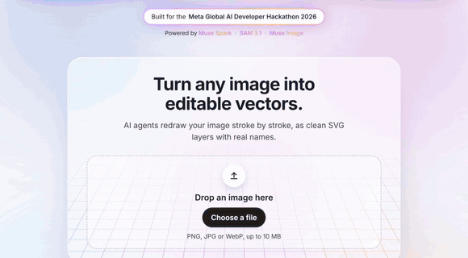
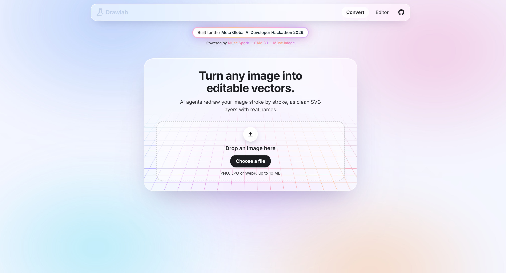
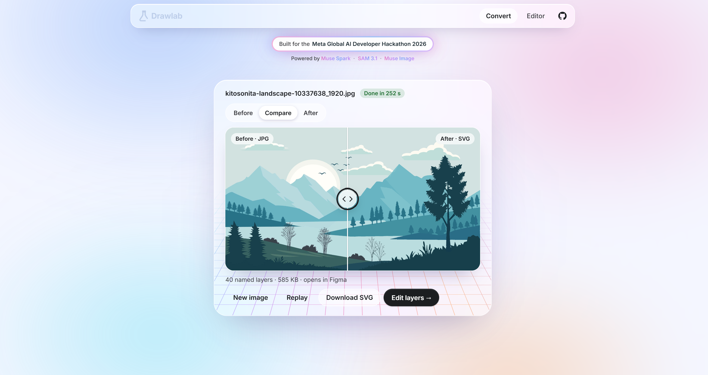
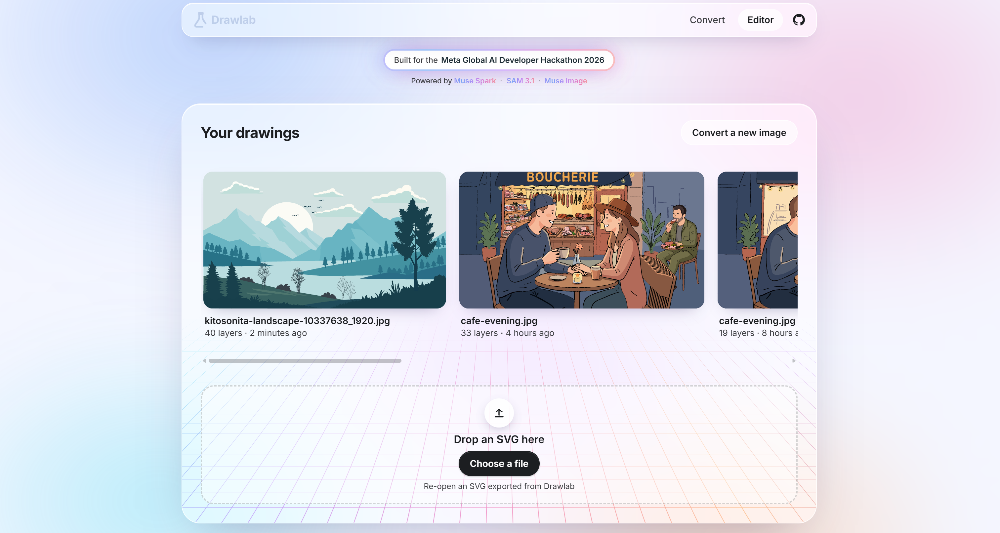
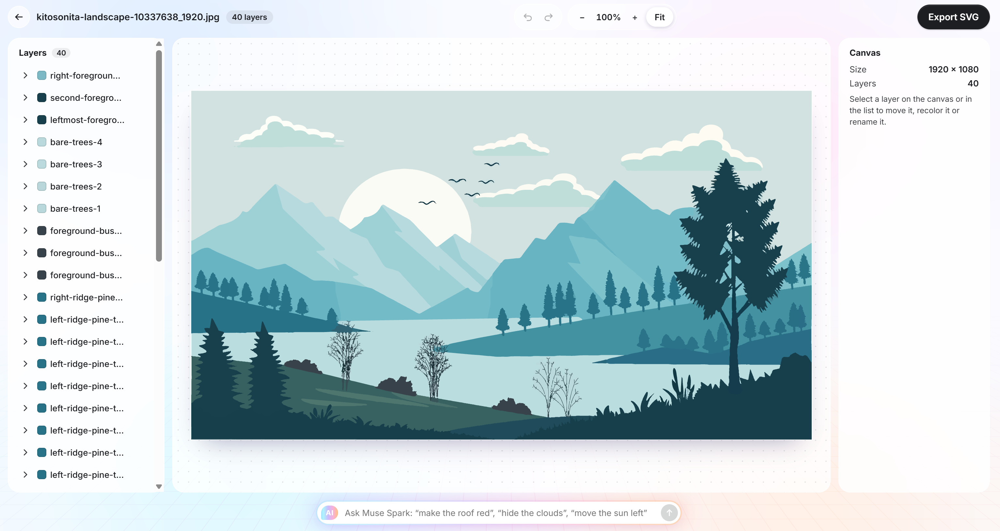
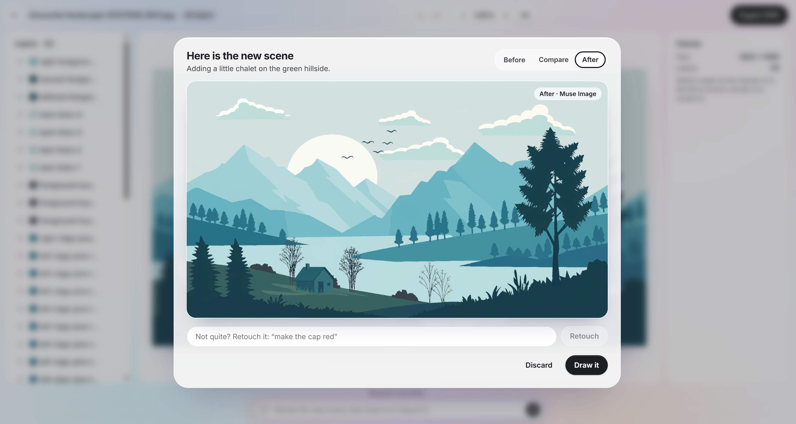
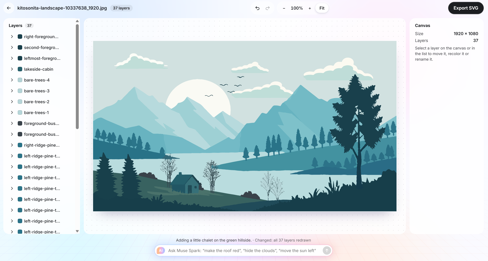
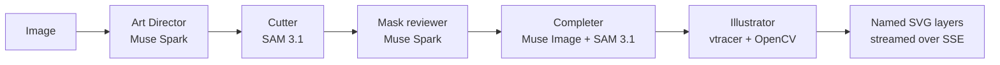

# Drawlab


**The AI that doesn't generate. It draws.**

Drop an image. A team of AI agents redraws it as vectors, live, stroke by stroke, and hands you a clean SVG whose layers have real names (`man-figure`, `cafe-storefront`, `lakeside-cabin`), not `path47`. Then edit the drawing by hand or just ask for a change in plain words.

<!-- Demo video: add the link here -->
<!-- Live app: add the URL here -->



## Why

Image generators give you pixels. Classic vectorizers give you hundreds of anonymous shapes. Neither is something a designer can open in Figma and keep working on.

Drawlab understands the image first, then draws it the way an illustrator would: one named, editable layer per element, in a sensible drawing order.

## How it works

1. **Drop an image** (PNG, JPG or WebP).

   

2. **Watch the agents draw it.** Muse Spark plans the layers, SAM 3.1 cuts every object, then the drawing appears stroke by stroke: light sketch lines, ink, then color. When it is done, drag the handle to compare the original with the SVG.

   

3. **Find your drawings again.** Every drawing is kept in your browser. You can also re-open any SVG exported from Drawlab.

   

4. **Edit the layers.** Each element has its own named layer: show or hide it, reorder it, rename it, recolor it, move it, duplicate it or delete it. Undo and redo work everywhere.

   

5. **Talk to the drawing.** Ask for a change in plain words.

   

6. **Review the proposal.** Muse Image repaints the scene first. Compare it with the current drawing, retouch it with another instruction, discard it, or click **Draw it**.

   

7. **Get a new vector drawing.** Drawlab redraws the whole scene as layers, keeping the existing layer names, and adds a named layer for the new element (here `lakeside-cabin`).

   

8. **Export the SVG.** It opens in Figma, Illustrator or Inkscape with every layer named.

## The agents

Meta models make the decisions. Classic tools guarantee the precision. No model ever writes the SVG on its own.



| Agent | Model | What it does |
| --- | --- | --- |
| Art Director | `muse-spark-1.3` | Studies the image and returns structured JSON: every element with a name, a kind, a position and a drawing order. |
| Cutter | `sam-3.1` | Turns each element name into a mask. Prompts run in parallel and instances are matched to the right element. |
| Mask reviewer | `muse-spark-1.3` | Checks the masks against the image and re-cuts the missing ones with boxes. |
| Completer | `muse-image-1.0` + `sam-3.1` | Rebuilds the hidden parts of objects that sit behind others, so moving a person reveals a whole chair, not a hole. |
| Illustrator | none (vtracer, OpenCV) | Traces the image once, separates ink from color, assigns every region to its element and writes one clean layer per element. |
| Edit Director | `muse-spark-1.3` | Reads a request and either applies layer operations directly (hide, move, reorder) or writes an instruction for Muse Image. |

Every agent event is streamed to the browser over Server-Sent Events, which is what lets the drawing appear live, layer after layer.

### Use of Meta models

- **Muse Spark** plans the drawing, reviews the masks and turns natural language into edits, always with structured output so the JSON matches a schema.
- **SAM 3.1** segments each element from a text prompt.
- **Muse Image** completes hidden parts and proposes visual edits on the whole scene, so new elements fit the style and the context.

## Budget guardrails

There is no spending cap on the platform, so the code protects the credits:

- A maximum number of API calls per job (`MAX_API_CALLS_PER_JOB`).
- A daily spending cap for the whole server (`MAX_DAILY_SPEND_USD`): once it is reached, every model call is refused until the next day (UTC).
- Each visitor gets 5 conversions and 5 AI edits per 24 hours, shown in a banner at the bottom of the page, and the server draws one image at a time.
- Images are downscaled before they are sent to the models.
- Every call is logged with its model, token usage and cost, and every pipeline stage with its duration.
- `MOCK_AGENTS=true` runs the whole pipeline on recorded responses, without calling the API.
- AI edits use a faster path: low reasoning effort for the Art Director, no mask review and no completion.

Measured on a typical illustration: about **$0.10 per drawing** and **$0.06 per AI edit**.

## Getting started

Requirements: Python 3.13, Node.js 24 and a Meta Model API key.

```bash
# 1. Configuration
cp .env.example .env              # then set MODEL_API_KEY, or keep MOCK_AGENTS=true

# 2. Backend (http://127.0.0.1:8000)
python -m venv .venv
.venv/Scripts/activate            # Windows. On macOS and Linux: source .venv/bin/activate
pip install -r requirements.txt
cd backend
uvicorn app.main:app --reload

# 3. Frontend (http://localhost:5173), in a second terminal
cd frontend
npm install
npm run dev
```

| Variable | Default | Purpose |
| --- | --- | --- |
| `MODEL_API_KEY` | empty | Bearer token for the Meta Model API. Never commit it. |
| `MODEL_API_BASE_URL` | `https://api.meta.ai/v1` | API endpoint. |
| `MAX_API_CALLS_PER_JOB` | `60` | Hard limit of model calls per drawing or edit. |
| `MOCK_AGENTS` | `true` | Use recorded responses instead of the real models. |
| `MAX_DAILY_SPEND_USD` | `5` | Server-wide spending cap per UTC day. |
| `MAX_CONVERSIONS_PER_VISITOR` | `5` | Image conversions allowed per visitor over 24 hours. |
| `MAX_EDITS_PER_VISITOR` | `5` | AI edits allowed per visitor over 24 hours. |
| `MAX_PROPOSALS_PER_VISITOR` | `30` | Muse Image proposals and retouches allowed per visitor over 24 hours. |
| `ALLOWED_ORIGINS` | empty | Comma-separated frontend origins allowed to call the backend (CORS), such as `https://drawlab.vercel.app`. |
| `VITE_API_URL` | `/api` | Frontend only: backend URL when the frontend and the backend are hosted apart. |
| `FRONTEND_DIR` | empty | Folder of the built frontend that the backend serves at `/` (set in the Docker image). |
| `FORWARDED_HOPS` | `1` | Proxies in front of the backend, used to read the visitor IP from `X-Forwarded-For`. |

## Deploy on Hugging Face Spaces

The `Dockerfile` builds the frontend and serves it from the backend, so the whole app runs as one free Docker Space.

1. Create a Space on Hugging Face with the **Docker** SDK and the **CPU basic** hardware.
2. In the Space settings, add the secret `MODEL_API_KEY`, and optionally the budget variables above.
3. Commit, then run `python scripts/deploy_space.py <user>/<space>`. It pushes the code without images or docs, and adds the Space header to the README.

## Project structure

```text
backend/app/
  agents/        Art Director, Cutter, Mask reviewer, Completer, Illustrator, Edit Director
  pipeline.py    Runs the agents and streams their events
  main.py        FastAPI routes under /api (draw, edit, repaint/proposal, repaint, quota), and the built site at /
  guardrails.py  Visitor quotas, single drawing slot and daily spending cap
frontend/src/    React app: converter, drawing animation, layer editor, talk bar
scripts/         Benchmarks and tools to try the agents on sample images
docs/images/     Screenshots and demo
```

## What we built and what we reused

**What we built** during the hackathon:

- The six agents and the pipeline that chains them, with streaming over SSE.
- The layering logic: element naming, mask matching, hidden part completion, one layer per element.
- The Illustrator algorithms on top of the tracer: ink detection, region ownership, smoothing, gap sealing.
- The whole web app: converter, stroke-by-stroke animation engine, before and after comparison, drawings gallery, layer editor, talk bar and proposal review.
- The budget guardrails and the mock mode.

**What we reused**:

- Meta models: Muse Spark, SAM 3.1 and Muse Image, through the Meta Model API.
- Backend libraries: FastAPI, Uvicorn, Pillow, NumPy, OpenCV, vtracer, resvg-py, the OpenAI Python SDK (the API is compatible with it), meta-sam-parser, python-dotenv and python-multipart.
- Frontend tooling: React, Vite, TypeScript and oxlint.

## Limitations

- A drawing takes about 4 to 5 minutes. An AI edit takes about 20 seconds for the proposal and 1 to 2 minutes for the redraw.
- Drawlab works best on illustrations and flat artwork. Photos give many more, less meaningful layers.
- Recoloring by hand changes a whole tone family, which can include other parts of the same layer.

## Hackathon

Built for the **Meta Global AI Developer Hackathon 2026**, Indie Developer track, theme *Build for Your World*.
Development started on October 26, 2026 at 2:30 PM ET.

## Credits

All images used in this repository are original or free-licensed. No brand assets or copyrighted characters are used.

- Mountain landscape: illustration by kitosonita on Pixabay.

## License

[MIT](LICENSE)
